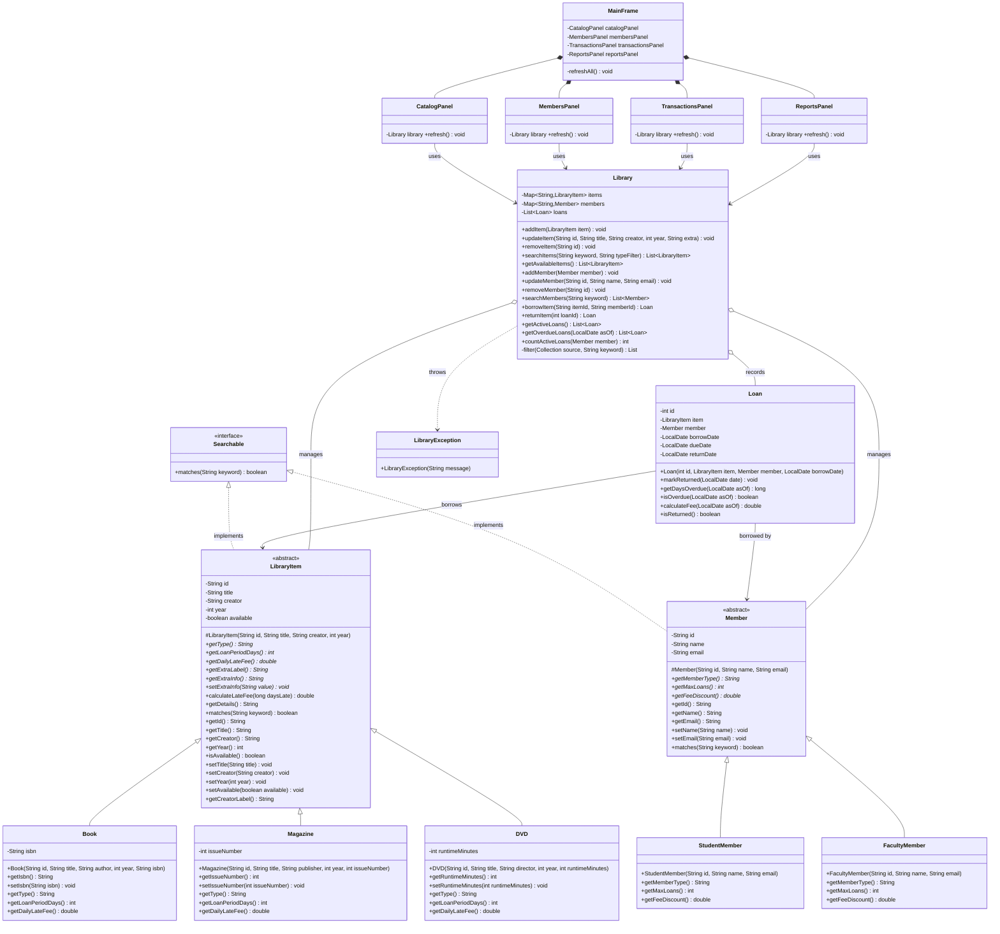

# UML Class Diagram

GitHub renders the Mermaid diagram below automatically.
For your submission, you can also paste the code into https://mermaid.live and export a PNG/SVG.

Legend: `+` public, `-` private, `#` protected. `<<abstract>>` and `<<interface>>` mark abstraction.

